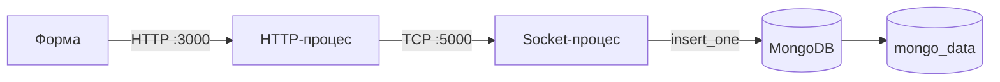

# Як працює застосунок

`main.py` запускає два процеси через `multiprocessing` із методом `spawn`.
HTTP-процес обслуговує сторінки й приймає форму. TCP-процес розбирає повідомлення
та працює з MongoDB. З'єднання з БД створюється саме в TCP-процесі.

Frontend збирається в `frontend/out/`. Python віддає ці файли, включно зі
`style.css`, `logo.png` та `error.html` для 404. Docker збирає frontend через Node.js,
а готовий застосунок запускає в Distroless Python 3.13.

## Надсилання форми

HTTP приймає URL-encoded поля `username` та `message` і передає їхні початкові
байти через TCP. Socket-сервер декодує UTF-8, створює словник, перевіряє поля
та додає `date` через `datetime.now()`. Час має мікросекунди; у контейнері використовується UTC.

Успішна відповідь повертається лише після підтвердження `insert_one()` від MongoDB:
`201` для JSON або `303` для звичайної HTML-форми. Дані документа не містять
службового request ID.

Є важливий випадок: запис уже відбувся, але підтвердження загубилося. Тоді клієнт
може отримати 503, хоча повідомлення вже є в БД. Автоматичного повтору немає,
а ручне повторення може створити дублікат. Цей випадок перевіряється окремим тестом.

## TCP-протокол

На одному з'єднанні передається один запит і одна відповідь.

| Частина | Вміст |
| --- | --- |
| Початок кадру | 4 байти довжини payload, unsigned big-endian (`!I`) |
| Payload запиту | `MSG1` + 16 байтів UUID + байти форми |
| Максимум | 65 536 байтів форми та 20 байтів службового заголовка |
| Payload відповіді | `OK`, `INVALID` або `UNAVAILABLE` |

Довжина включає службовий заголовок. Невідома версія або некоректний кадр відхиляється
до звернення до БД. HTTP і TCP оновлюються разом, старий формат кадру не підтримується.
Порожнє тіло після заголовка означає перевірку MongoDB через `ping`, без запису.

`receive_exact()` дочитує потрібну кількість байтів: один `recv()` може повернути
тільки частину повідомлення. На заголовок і тіло діє спільний час очікування,
тому надсилання по одному байту не дозволяє тримати з'єднання без кінця.

## Логи й завершення роботи

Валідний UUID із `X-Request-ID` проходить через HTTP, TCP та лог операції БД.
Якщо UUID немає або він неправильний, сервер створює новий. Події містять результат
і `duration_ms`, але не текст форми, паролі чи заголовки авторизації.
`database_operation_completed` показує час лише операції БД; HTTP-подія — всього запиту.
Request ID допомагає знайти запит у логах, але не забезпечує дедуплікацію.

При зупинці спочатку завершується HTTP, поки TCP ще може обробити прийняті форми.
Потім закриваються TCP і MongoClient. Якщо один worker аварійно завершується,
батьківський процес зупиняє другий і виходить із помилкою.
